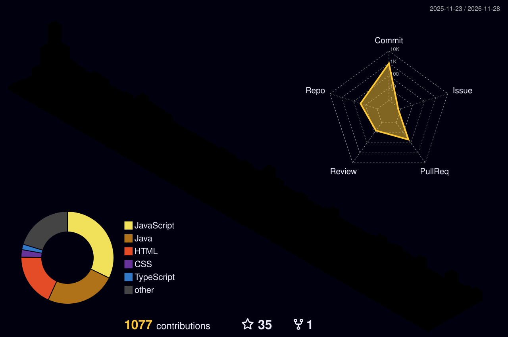

  

  

 

---

> **Current Status:** Java + Spring Boot + PostgreSQL Backend Developer | GDG & Technovation Lead | GSoC & GSSoC '26 Aspirant

  &nbsp;&nbsp;&nbsp;&nbsp;&nbsp;&nbsp;

---

<table>
  <tr>
    <td width="50%" valign="top" padding="15px">
      <h3 align="center">💻 Tech Stack</h3>
      

        
          
        
          
        
          
        
      

    </td>
    <td width="50%" valign="top" padding="15px">
      <h3 align="center">🎨 Creative Studio</h3>
      

        
      

      

      <h4 align="center">🏆 Creative Milestones</h4>
      <ul>
        <li><b>2nd Place:</b> Reel Mind Pictures (Expressions 2021)</li>
        <li><b>Event Design:</b> Google Ambassador Freshers' Party</li>
      </ul>
    </td>
  </tr>
</table>

---

### 🚀 About Me
* ⚙️ **Backend & Databases:** Architecting scalable REST APIs and relational schemas with **Java**, **Spring Boot**, and **PostgreSQL** alongside **220+ DSA** problems solved (**3★ Java** on HackerRank).
* 🌐 **Frontend & Systems:** Creator of [**Vadanta OS**](https://vadanta.is-a.dev) — an interactive cyberpunk web OS built with **React 19**, **Vite**, **Tailwind CSS**, **GSAP**, and **Canvas API**.
* 🛰️ **Leadership & Experience:** Core Web Team at **GDG On Campus ABESEC** ([gdgabesec.xyz](https://gdgabesec.xyz)), Technical Lead at **Technovation** ([dsavation.vercel.app](https://dsavation.vercel.app)), and **Deloitte** Tech Simulation participant.
* 🤖 **Cloud, AI & Open Source:** **Oracle AI Certified** & **10+ Google Cloud Skill Badges**; **MLH HackDays Top 33 / 120+**; targeting **GSoC & GSSoC '26**.

---

### 🏆 Featured Certifications & Achievements
| Credential | Issuer | Verification |
| :--- | :--- | :--- |
| **AI Certified Foundations Associate** | Oracle | [View Certificate](./milestones/Oracle_GenAI.pdf) |
| **Technology Job Simulation** | Deloitte | [View Certificate](./milestones/Deloitte_TechnologyJobSimulation.pdf) |
| **HackDays Hackathon (Top 33 / 120+)** | MLH HackDays | [View Certificate](./milestones/Hackathon_01_Hackdays.pdf) |
| **Student Ambassador Program (Freshers' Party)** | Google | [View Certificate](./milestones/Google_StudentAmbassador.pdf) |

  
<b>✨ View 10+ More Certifications (Click to Expand)</b>

   

  **🤖 AI & Modern Developer Workflows (Wilco)**
  * **GitHub Copilot Quests:** [Prompt Engineering](./milestones/WilcoLabs/prompt_engineering.png) | [Copilot Integration](./milestones/WilcoLabs/copilot_integration.png) | [Magic Quest](./milestones/WilcoLabs/magic_quest.png) | [Code Smarter](./milestones/WilcoLabs/code-smarter.png)

  **💻 Core Technical & Problem Solving**
  * **HackerRank:** [Profile (3★ Java)](https://www.hackerrank.com/profile/codegrounds666) | [Basic Problem Solving](./milestones/HackerRank_PS_Basic.pdf) | [JavaScript Basic](./milestones/HackerRank_Js_Basic.pdf)
  * **freeCodeCamp:** [Legacy Responsive Web Design](./milestones/FreeCodeCamp_WebDesignV8.pdf)

  **🎨 Competitions, Hackathons & Community**
  * **CodeChef:** [Clash of Coders](./milestones/Codechef_ClashOfCoders.jpg)
  * **IIT Roorkee E-Cell:** [Participation Certificate](./milestones/IITRoorkie_Ecell.png)
  * **HackerRank Events:** [CodeWizard](./milestones/Hackerran_CodeWizard.png)

---

<h3 align="center">🛜 Connect with Me!</h3>

  &nbsp;&nbsp;&nbsp;&nbsp;&nbsp;&nbsp;

   
  

 
<h3 align="center">🚀 Featured Projects</h3>

<table align="center">
  <tr>
    <td width="50%">
      
    </td>
    <td width="50%">
      
    </td>
  </tr>
  <tr>
    <td width="50%">
      
    </td>
    <td width="50%">
      
    </td>
  </tr>
  <tr>
    <td width="50%">
      
    </td>
    <td width="50%">
      
    </td>
  </tr>
</table>

 

---

 

<h3 align="center">🧱 My Code Architecture</h3>

  

